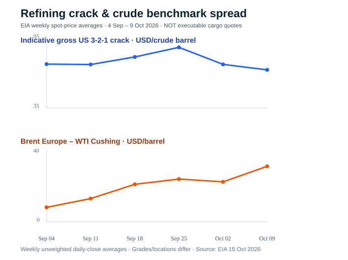

# Energy Trading: Refining Margins & Transatlantic Arbitrage

**A reproducible commodity-markets research portfolio project for physical-energy trading.** Analyse petroleum crack spreads, benchmark differentials, cargo-cost assumptions and scenario risk using public US Energy Information Administration (EIA) observations.

> **Research prototype — not a trading signal.** EIA observations are **weekly averages**, not executable bid/ask quotations. WTI Cushing versus Brent Europe is **not** a tradable US Gulf Coast FOB / European CIF arbitrage. All hypothetical shipping and quality costs are user-editable assumptions, not verified broker quotes.



### Questions
1. How have indicative US 3-2-1 crack margins changed, and what crude/product price inputs explain the *arithmetic* change?
2. How sensitive is a hypothetical US-to-Europe crude export screen to inland logistics, freight, financing, quality basis and volume loss?
3. What physical quotations and real-world supply-demand information would be needed before considering an actual trade?

### Run locally

Python 3.10+:

```bash
python -m venv .venv
# Activate the virtual environment for your operating system
python -m pip install -e '.[dashboard,dev]'
python -m pytest -q
energy-trading report
streamlit run dashboard.py
```

The bundled six-week EIA sample requires **no API key** and is dated through the week ending **9 October 2026**. It is not live market data.

To refresh the historical series from the official EIA API (free key: https://www.eia.gov/opendata/register.php):

```bash
export EIA_API_KEY=your_key_here
energy-trading fetch --output data/eia_weekly_live.csv
energy-trading report --data data/eia_weekly_live.csv
```

For the dashboard, set **Local data CSV** to `data/eia_weekly_live.csv`. Do not commit API keys.

### Models and conventions

**Gross indicative 3-2-1 crack (USD per barrel of crude input):**

```
crack = (2 * 42 * gasoline_USGC_$/gal + 42 * ULSD_USGC_$/gal - 3 * WTI_Cushing_$/bbl) / 3
```

It is **not** refinery profit or refinery-specific yield economics, and it contains Cushing/US Gulf Coast location basis.

**Hypothetical cargo screen (USD/input barrel):**

```
screen = Brent_Europe * (1 - volume_loss_fraction) - WTI_Cushing
         - inland - ocean_freight - terminal - insurance - financing - grade_basis
```

This is a transparent *what-if* model, **not** an executable cargo trade, forecast, arbitrage return or P&L estimate. A real decision requires compatible grades and laycans, same-basis FOB/CIF quotes, vessel availability and charter rates, demurrage, insurance, port terms, tariffs, inventories and hedge exposure.

### Source and provenance

The six original weekly averages (4 Sep–9 Oct 2026) are from [EIA Spot Prices for Crude Oil and Petroleum Products](https://www.eia.gov/dnav/pet/pet_pri_spt_s1_w.htm), published **15 October 2026**. Units: WTI Cushing and Brent Europe in USD/bbl; US Gulf Coast gasoline and ULSD in USD/US gallon. EIA weekly averages are unweighted arithmetic averages of daily closing assessments.

Price data and examples are immutable offline snapshots; automated `fetch` requires a user-supplied EIA API key and **fails rather than substituting fake data**.

### What the project does — and doesn't do
- Reconciles the exact week-to-week change in crack spread across crude, gasoline and diesel factors (mathematical attribution, **not** causal explanation).
- Provides an editable physical differential cost stack and Brent/freight sensitivity grid.
- Exports dated, unit-labeled calculations for review and runs automated mathematical and data-integrity tests.
- Does **not** claim predictive returns, a trading backtest, real vessel quotes, seasonal validation, trading authorization or executable margins.

See [research note](docs/RESEARCH_NOTE.md) and [CV wording guidance](docs/CV_USAGE.md). Next improvements: longer price history, EIA inventories/refinery utilization, documented historical supply disruptions, time spreads, and a separate naphtha-versus-LPG petrochemical feedstock model.

**Interview question to ask:** *What actually changed in the physical market, where is the bottleneck, what can be hedged and what would invalidate the trade thesis?*

MIT License · Educational use.